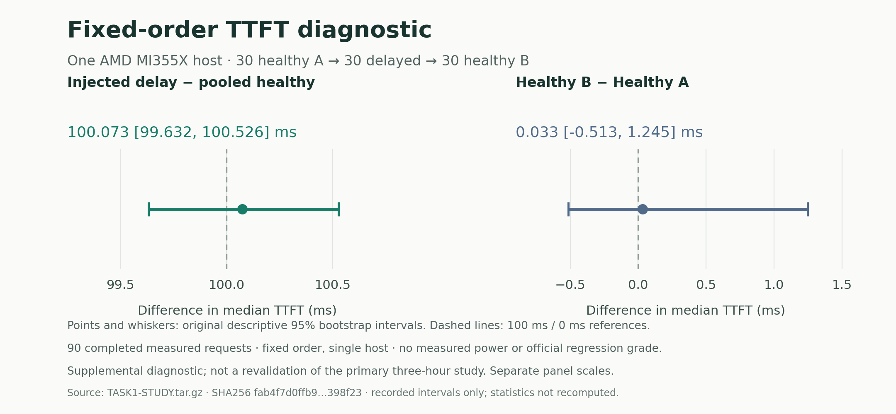

# Fixed90 real-engine point diagnostic — 30 October 2026

Recorder 1.1.1 completed a new fixed-order study on one AMD MI355X with the locked LLMD/Qwen3.6-27B baseline: **30 clean A → 30 first-visible-content delays of 100 ms → 30 clean B**. All 90 measured requests and one additional startup probe completed. This is separate supplemental work outside the original primary three-hour envelope. It does not rerun the full suite, repair missing historical evidence, establish measured power, or assert an official grade.

| Arm, in execution order | Planned/offered/completed | Failures or invalid evidence |
|---|---:|---:|
| Clean A |30/30/30|0|
| Inject 100 ms before first visible final-content SSE frame |30/30/30|0|
| Clean B |30/30/30|0|

All 30 injections were verified from original monotonic delay events. All 90 measured upstream/downstream SSE bodies were retained byte for byte, with complete HTTP 200/DONE/EOF evidence. The original frozen completion and raw-stream validators passed. The independent timing audit passed. A separate replay rejudged all 90 measured requests plus startup with the pinned target tokenizer, verified all 382 payload hashes, and reproduced both reported intervals exactly.

| Descriptive median TTFT difference | Point,ms |95% percentile-bootstrap interval,ms| Samples |
|---|---:|---:|---|
| Injected delay − pooled clean controls |100.073|99.632 to 100.526|30 delayed; 60 controls|
| Healthy B − healthy A |0.033|−0.513 to 1.245|30 per arm|



These are the original recorded independent-request, 2,000-resample descriptive intervals, not a reselected threshold or a new power estimate. The A/A interval includes zero. One host, one fixed ordering and one study do not establish a general false-positive rate, population coverage or repeated-experiment detection power. No primary full-suite validation is replaced or pooled with these samples. The [figure provenance and optional standalone Matplotlib reproducer](figures/README.md) use this exact archive and only convert seconds to milliseconds.

## Timing, validity and original evaluator result

The measured-window recorder collected **10,067 lag samples**, maximum **2.063 ms**, p99 **1.983 ms**, under the unchanged **50 ms** limit. GC was disabled only in measurement windows. This exercises the current recorder's rule on this study; it cannot establish unobserved host behavior or retroactively fill the original full run's missing boundary-lag samples.

The wrapper's new physical container/process took **33.629819 seconds** to the first valid completed generation. That is one startup point, not a startup-stability result or host page-cache-cold claim. The recorder attached through the proxy and retained `cold=false`. The **original evaluator remains `inconclusive`, exit3**, because it has no runner-owned cold launch. Its status is not replaced with the wrapper point. Runner and timing-audit exits were 0.

Capture, owned stop and validity checks took **143.024 seconds** within the frozen 180-second cap. The exact owned container was absent, its supervisor was reaped, and the proxy had no active request at stop. The helper's completion receipt and full native offhost archive verification passed before the stronger original delete−35 bound. The additional Windows replica was hash-verified after cloud deletion; it is a separate local copy, not a claim that Windows verification preceded DELETE.

## Evidence and reproduction

[`capture.tar.gz`](capture.tar.gz) is the **unchanged 383,385-byte** original export, SHA-256 `fab4f7d0ffb9d1bf5625664f01d32b79a20afee4f1afcbbd454e2bacbb398f23`. It has 382 hashed payload files plus the original manifest: run/requests, all raw upstream/downstream streams and injection events, original report, timing audit, logs, owned cleanup and frozen plan. No model weights, coding-model SDK sessions, provider token, shared financial Journal or puzzle material is included.

[`SOURCE-PINS.json`](SOURCE-PINS.json) binds 35 actual source files at `96a9fa5a716d54a9700d14627fe184dec4e7dedc`. [`study_driver.capture.py.txt`](study_driver.capture.py.txt) is the exact frozen helper (SHA `eba5fc8b5c8bbb56e617c34f0ea0499475e73d2e01a37605209893e29d3ecbb2`); [`fault_proxy.capture.py.txt`](fault_proxy.capture.py.txt) is its original transport. Neither changes the closed earlier default 11-request helper. The exact descriptive statistic implementation is [`stats.capture.py.txt`](stats.capture.py.txt). File extensions label execution evidence; Python can read these files directly.

Verify the entire archive without extracting it or using a GPU:

```bash
PACKET=tasks/benchmark-design/validation/engine-fixed90-supplemental-20261030
python -B "$PACKET/study_driver.capture.py.txt" --verify-export "$PACKET/capture.tar.gz"
```

The [independent replay](independent-replay.json) records current-tokenizer gate replay, exact raw-stream checks and both unchanged CIs. [`effects.json`](effects.json) retains all three actual 30-sample groups. [`completion.json`](completion.json), [`resource-closure.json`](resource-closure.json) and [`manifest.json`](manifest.json) distinguish capture, offhost delivery and resource closure. The archive's original report is authoritative for its `inconclusive` evaluation result.

## Resource closure and retained failures

The new allocation's original T0 was **13:09:53.805015 UTC**. Capture ran **13:13:42.556373–13:16:05.176412 UTC**. Original work/delete/absence deadlines were **13:18:23.805015 /13:19:53.805015 /13:20:53.805015 UTC** and never moved. After complete offhost export, exact owned identity was checked and DELETE returned 204 at **13:16:08.406073 UTC**. A later GET returned 200 and its identity check raised `IdentityMismatch`, causing nonzero controller/parent cleanup exits. The second 200 response body was not retained, so the differing identity field and cause are unknown. This is a **post-DELETE polling identity-check error**, not a failed capture or evidence of a certified provider name/tag transition.

The independent original watchdog confirmed exact GET404 at **13:16:21.636356 UTC**, and the original accounting Journal closed at **13:16:21.667504 UTC**, before the unchanged absence deadline. No GPU or coding-model request remained active. The conservative resource charge upper is **US$0.46, pending provider invoice**, with zero new coding-model API requests. This is not an account-balance or total-spend statement. All earlier unknown liabilities remain retained. Private administrative/source/accounting evidence is preserved by hash; no missing 200 response body was manufactured. See the [precise cleanup disclosure](cleanup-evidence-precision.json).

Both preceding free CPU fixed90 fixture attempts remain **invalid for measured-window lag**, with reported 245 ms/759 ms versus 50 ms. Their original temporary directories were missing on later read, so original lag sample timestamps cannot be independently reaudited. The [failure observation](prior-failed-free-CPU-fixtures.json) retains that gap; the later synthetic positive fixture was not a real healthy 90 result. This new GPU study supplies separate actual healthy 90 evidence without relabelling those failures.

The earlier [28 October primary capture](../../REAL-RUN-20261028.md), its original three-hour clock, full/quick/calibration files and the closed [11-request diagnostic](../engine-diagnostic-20261030/README.md) remain unchanged. Combined exclusive setup/cleanup time across later shared studies is not certified within the primary three-hour envelope. These fixed90 data are explicitly later supplemental evidence.
