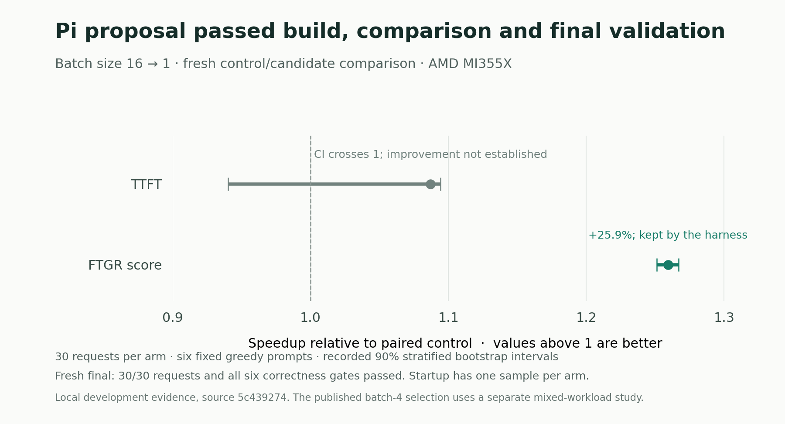

# Completed canonical Pi → GPU experiment, 30 October

A genuine unchanged stock Pi 1.0.0 process, using GLM-5.2, authored a single `--batch-size=16` → `1` patch on CPU. The declared [one-response/no-tools overlay](../../PI-ONE-RESPONSE.md) requested one strict JSON response, output cap2048, and provider JSON-object mode. It did not activate Pi's baseline four tools. The controller parsed the final model fields and wrote the files without repairing the patch, base pin, knob or hypothesis. The prior malformed-patch and prose responses stayed failed.

The strict artifact verifier bound the exact model text, SDK response, provider stream, terminal usage, original accounting receipt, source, playbook, baseline profile, workload, immutable base and model. CPU inference stopped before GPU allocation. The GPU then ran the canonical `Harness.run()` with `VerifiedCompletedPiProposal`: fresh baseline → fresh candidate build → control/candidate measurement → KEEP. A separate wrapper ran a fresh selected-image final 30 and exported its exact image metadata. The GPU made **zero coding-model calls**. This was a deferred CPU/GPU phase boundary, rather than one continuous Pi/GPU process or a new Pi call inside the GPU loop.

Runtime source was [`5c439274e2d3744da68b310c769c96b0c78bfb92`](https://github.com/sharonbasovich/performance_takehome/commit/5c439274e2d3744da68b310c769c96b0c78bfb92); its recorded harness-tree hash is `8d1b1d315337cfca4457ba51032401cf2910691011e39d5250fb67207cd134e2`. Later documentation commits do not alter that recorded execution source. [Compatibility](COMPATIBILITY-VERIFIED.json), [CPU provenance](cpu-provenance.json), the exact [model patch](proposal.patch), and exact [built Dockerfile](original-built-candidate.Dockerfile) retain the boundary and inputs. The unchanged model is Qwen3.6-27B at the locked revision on one MI355X VF.

| Phase | Actual benchmark requests | Durable startup probes | Six correctness gates |
|---|---:|---:|---|
| Fresh unpatched baseline |30|1|Pass|
| Paired control |30|1|Pass|
| Model-authored candidate |30|1|Pass|
| Fresh selected-image final |30|1|Pass|

Each phase directory contains the original worker `full-report.json`, its 30 durable `request-traces.jsonl` events, original startup result/probe journal, and extracted per-prompt samples. These are **120 measured benchmark requests plus 4 startup probes**. The journals were written/fsynced by the actual worker before subsequent requests; they are not reconstructed from the final report. `golden.json` comes from the actual fresh-baseline state: the initial baseline's sixth gate establishes that reference, while later phases compare against it. These are self-consistency/reference checks, not independent semantic ground truth. Extracted samples preserve the actual worker's prompt-group order so the seeded bootstrap is exactly replayable. The [source reports](reports/) preserve the full canonical baseline and paired decisions with private host paths aliased.

| Paired serial development metric | Speedup |90% stratified bootstrap interval| Verdict |
|---|---:|---|---|
| Etalon FTGR |1.259329|[1.251227,1.266861]|Supported improvement|
| TTFT |1.087023|[0.940236,1.094201]|No supported change|

The [canonical decision](decision.json) kept the candidate on FTGR. TTFT's interval crosses1; its point estimate is not an established gain. Control/candidate startup observations were 28.050/27.122 seconds, with only one startup per arm, so no statistical startup improvement is claimed. The fresh final startup was 27.562 seconds and all 30 requests passed all six gates. This run measured the existing six-prompt serial workload; it supplies no new concurrency, long-input or unseen-workload result.

The [SVG](figures/canonical-paired-result.svg) and [figure provenance/data](figures/FIGURE-PROVENANCE.json) display the original recorded decision intervals. No statistics were recomputed for the figure; it is not a comparison with the separately recommended batch 4 image.

## Current submission and image distinction

The recommended submitted image remains the separately verified **batch 4** image:

`ghcr.io/sharonbasovich/performance_takehome-task2-llmd@sha256:84d13e8e4f6777ec4522d701d86e16181c0b170602a7e81db17dab7df525cabb`

Its prior controller-neighbor/mixed-policy selection, final 30, complete anonymous graph and actual anonymous Docker pull/help proof remain [in the prior packet](../live-mi355x-20261028/README.md). The current canonical model chose batch 1, not 4. No head-to-head evidence from this new run establishes that 1 beats 4. Its fresh baseline resets the comparison; the new improvement is not added to the older reported gain.

The new batch 1 Docker-local image index was `sha256:1c9adb64f064017af5201eb7cac08fbe12627bad15ad1ba8107fa2e1bac36a7f`. The retained [raw platform manifest](selected-metadata/manifest.json) is `sha256:93f4b72539b0e9cec3a21ed9c2c0c1ec74e876791318456bebf36182a52ce2c9`; [raw config](selected-metadata/config.json) is `sha256:baeb12d7ad78daa8ff91486696ae94056542576afbceff24bfcc75db7857a0e0`. Those identities differ by design. All 23 inherited layer triples and rootfs diffIDs were retained. The [experimental batch 1 image is also publicly verified](publication-note.md): immutable 93f4b, all 25 anonymous objects/5,923,167,708 bytes, actual Docker pull/inspect/CPU help and owned-container absence passed at exact publication head 41456da. Its delivery does not replace the recommended batch 4 image or establish superiority over 4. No bit-reproducible build claim is made.

## Logs, costs and retained failures

The main [`harness/results.tsv`](../../results.tsv) is this real two-row canonical experiment log. Only its `development_report` and `patch_path` cells were changed to repository-relative paths; all metric, decision, cost, source and other cells are unchanged. The exact native [raw TSV](raw-results.tsv) and [path map with both hashes](result-path-map.json) make that transformation explicit. The invalid original 14-row CPU stand-in log remains [byte-exact in history](../history-cpu-standin-20261024/README.md); it is not current performance evidence.

[Attempt history](attempt-history.json) retains the 13-call full-tool CPU research failure ($0.5076162 upper), malformed-patch call ($0.0144292), prose/format call ($0.0196708), and valid JSON-mode call ($0.0144352). The valid call used 9148 input and 370 output tokens. Its settled upper is charged once on CPU and carried into the GPU log as provenance, rather than charged a second time. A first sealing attempt rejected digit-bearing private evidence filenames; a versioned filename-alias adapter preserved original bytes/paths and then passed the unchanged public verifier. This was a metadata fix, not patch repair or promotion of failed output. Older unknown liabilities and failures remain retained. These amounts are known attempt costs, not a complete account invoice.

[Prior baseline-only GPU history](baseline-only-history.json) also retains allocation 614111949's 210 baseline/final traces and 7 provider requests ($0.1339892 upper), plus 614151330's 90 baseline/retry/final traces and 10 requests ($0.2309182 upper). Neither completed a built/measured candidate pair; a late partial model edit was not measured. Nested closed archives independently confirm the latter30+30+30 count. Source/closure/archive hashes remain bound to the original private records. These are separate failed histories, not added gains, a replacement current log or a deduplicated grand total.

The complete2,669,038-byte private GPU export was independently verified offhost before deletion, SHA `7488e8adac3d67c148c8dbea3d90b37de92e280a10c1885de3cab41c040fffc5`. Root observed provider GET404 at `2026-10-30T11:45:11.075182Z`, before the unchanged cleanup deadline; controller and watchdog exited cleanly. Raw model SDK text, full prompt, unsuccessful prose, provider streams/WAL, shared financial Journal, host caches and credentials remain private. The [provenance map](provenance-map.json) identifies exact copied members versus JSON/path sanitization; the [inventory](inventory.json) hashes every public packet file.

These results establish a real canonical optimization cycle and local development evidence. The organizer's private evaluator has not run, and no official grade or complete task certification is claimed.

For exact historical replay, use the retained worker-order samples with runtime 5c's decision code. That version's finite seeded bootstrap depends on prompt-group insertion order. Sorted traversal and a JSON-key permutation regression are a recommended future policy version; no reordered/recalculated interval replaces this run's recorded confidence bounds.
